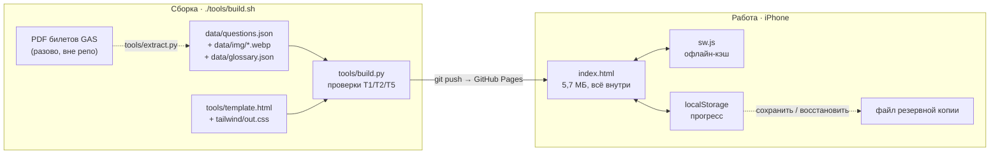

# Архитектура

> Статус: v1.2 · 18.10.2026 · **Offline-first PWA, статическая сборка (JAMstack), local-first хранение прогресса, без бэкенда.** · Рабочая копия документа: Claude Docs «Vozački test — архитектура и ADR».
> Решения — в [adr/](adr/), версии — в [ROADMAP.md](ROADMAP.md), аналоги — в [COMPETITORS.md](COMPETITORS.md).

## 1. Назначение и границы

Тренажёр готовит к теоретическому экзамену на права категории B в Черногории (theory driving test, category B) человека, который говорит по-русски, а сдаёт на черногорском. Цель v1 — стабильно набирать на имитации экзамена не менее 68 из 80 баллов (порог 85%) [1][2].

- **Пользователь v1:** один человек, iPhone, 2–4 недели подготовки.
- **В скоупе:** 412 вопросов официального каталога (черногорская часть) [3]; перевод RU и подсказки; режимы «Учёба», «Ошибки», «Экзамен», «Прогресс», «Словарь»; работа без сети.
- **Вне скоупа v1:** практическая часть, аккаунты, оплата, нативное приложение, категории A/C/D.

## 2. Схема

Сборка (build time) выполняется одной командой при изменении базы; в работе (runtime) сервера нет.



Продукт один — офлайн-приложение (ADR-0006). Онлайн-артефакт на claude.ai, сделанный на старте, больше не обновляется.

## 3. Модель данных

**Вопрос** (`data/questions.json`, единственный источник):

| Поле | Тип | Смысл |
| --- | --- | --- |
| `id` | строка, 8 hex | стабильный ID = sha1 от текста вопроса, вариантов, порядка и картинки (ADR-0010) |
| `legacy` | число | номер по порядку в PDF (v1.0); нужен только для переноса старого прогресса |
| `page`, `sec` | число, строка | страница PDF; раздел |
| `q` / `qr` | строка | текст ME / RU |
| `o[]` | 3 объекта | `t` текст ME, `r` текст RU, `ok` верный |
| `order` | строка | «4213» — только для вопросов о порядке проезда |
| `img` | строка | имя файла `data/img/<hash>.webp` (≤ 640 px); в сборке встраивается в HTML |
| `n` / `f` | строка | подсказка / пометка спорного ключа |
| `s` | объект | только вопросы о знаках: `code`, `name` по Правилнику, `ru` — значение (v1.2) |

**Прогресс** (`localStorage`: `vt-stats`, `vt-exams`, `vt-ru`): `stats{id: {right, wrong, streak, t, box, due, flag}}` (`box`/`due` — расписание повтора, ADR-0012), `exams[{at, score, pass, n}]`, `ru`. Резервная копия — тот же JSON с полем `app: "vozacki"`; при восстановлении записи сливаются по времени ответа `t`.

## 4. Модули

| Модуль | Функция | Статус |
| --- | --- | --- |
| M1 Pipeline данных | PDF → вопросы, ключ, картинки (знак + табличка склеиваются), разделы | v1.0 |
| M2 Локализация | RU-перевод, подсказки `n`, флаги `f`, глоссарий ~40 терминов | v1.0 |
| M3 Учёба | очередь невыученных, RU по кнопке, тап по термину → перевод | v1.0 |
| M4 Повтор и «Сложные» | интервальные повторения 0/1/3/7 дней, флажки, перемешивание вариантов (ADR-0012) | v1.2 |
| M5 Экзамен | 43 вопроса пропорционально разделам, /80, порог 68, разбор | v1.0 |
| M6 Прогресс | индикатор готовности (ADR-0013), выучено по разделам, история экзаменов, топ-5 ошибок, резервная копия в файл | v1.2 |
| M7 Монетизация | оплата, выдача доступа | v3 |

## 5. Данные: состояние и качество

- 415 вопросов (412 в каталоге; 3 — артефакты переноса строк), 187 картинок, 10 вопросов на порядок проезда.
- **Ключ ответов — только из билетов GAS.** Официальный каталог (214 стр.) поля ответов не заполняет: сверить ключ не с чем.
- 6 вопросов со спорным ключом: № 87, 276, 356, 358, 390, 415 — в приложении помечены, ответ = ключ.
- Каталог содержит также албанский текст (стр. 50–97), вопросы C/D (стр. 98–115) и Правилник о знаках и разметке (стр. 116–213).

| № | Проверка | Порог | Статус |
| --- | --- | --- | --- |
| T1 | у каждого вопроса ровно 1 верный вариант (проверяется при каждой сборке) | 415/415 | пройдено |
| T2 | перевод вопроса и 3 вариантов (при каждой сборке) | 415/415 | пройдено |
| T3 | сверка ключа с официальным PDF | — | невозможно: ключа в PDF нет |
| T4 | вычитка 40 случайных вопросов (по 8 на раздел) | ≤ 2 смысловые ошибки | не выполнено |
| T5 | у вопросов «na slici» есть картинка и файл существует (при каждой сборке) | 0 пропусков | пройдено |
| T6 | офлайн: запуск с иконки в авиарежиме | работает | проверить на iPhone |

## 6. Как пересобрать

```bash
./tools/build.sh          # проверки + index.html, sw.js, manifest (нужен только python3)
./tools/build.sh --css    # то же + пересборка Tailwind, если в template.html менялись классы (нужен Node)
git add -A && git commit -m "…" && git push   # публикация на GitHub Pages
```

Сборка падает с перечнем ошибок, если не выполнена проверка T1, T2 или T5. Версия офлайн-кэша = хэш `index.html`, поэтому телефон подтягивает обновление при запуске с сетью.

Новый каталог от министерства: `python3 tools/extract.py новый.pdf` → `build/raw/` → сверка и перенос в `data/questions.json` (переводы новых вопросов) — отдельный проверяемый шаг. Стабильные ID сохраняют прогресс по неизменённым вопросам.

### Что не хранится в репозитории

- **PDF-источники.** Билеты GAS — материал автошколы с её водяным знаком, в публичный репозиторий не кладём. Официальный каталог (20 МБ) — по ссылке [3]. Обе копии лежат у владельца в `05.VD`.

## Источники

1. [Aktuelno.me — Trivić: novi testovi (80 bodova, prolaz 68)](https://www.aktuelno.me/clanak/trivic-novi-testovi-za-polaganje-voznje-tokom-narednog-mjeseca/), 21.02.2023.
2. [Novosti.rs — Nova pravila u Crnoj Gori za polaganje vozačkih ispita (43 pitanja)](https://www.novosti.rs/crna-gora/vesti/1236160/nova-pravila-crnoj-gori-polaganje-vozackih-ispita-voznju-ocenjuje-20-clanova-komisije-testovi-prevedeni-albanski-engleski-jezik), 10.05.2023.
3. [gov.me — Katalog ispitnih pitanja za polaganje teorijskog dijela vozačkog ispita](https://www.gov.me/dokumenta/c4096c73-e71d-4b03-931b-a8809c971772), 25.05.2023.
4. [PyMuPDF — документация](https://pymupdf.readthedocs.io/).

### Что не хранится в репозитории

- **PDF-источники.** Билеты GAS — материал автошколы с её водяным знаком, в публичный репозиторий не кладём. Официальный каталог (20 МБ) — по ссылке [3]. Обе копии лежат у владельца в `05.VD`.
- **Исходные картинки** (`data/img/`, ~42 МБ PNG) — восстанавливаются `tools/extract.py` из PDF; в приложении они уже встроены в `index.html` (WebP).
- **Tailwind:** конфиг и входной CSS — `tools/tailwind/`; сборка: `npx tailwindcss@3.4.17 -c tools/tailwind/tailwind.config.js -i tools/tailwind/in.css -o out.css --minify`.
