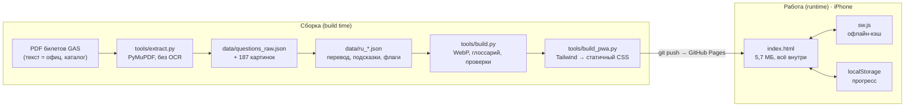

# Архитектура

> Статус: v1.0 · 17.10.2026 · Рабочая копия документа: Claude Docs «Vozački test — архитектура и ADR».
> Решения — в [adr/](adr/), версии — в [ROADMAP.md](ROADMAP.md), аналоги — в [COMPETITORS.md](COMPETITORS.md).

## 1. Назначение и границы

Тренажёр готовит к теоретическому экзамену на права категории B в Черногории (theory driving test, category B) человека, который говорит по-русски, а сдаёт на черногорском. Цель v1 — стабильно набирать на имитации экзамена не менее 68 из 80 баллов (порог 85%) [1][2].

- **Пользователь v1:** один человек, iPhone, 2–4 недели подготовки.
- **В скоупе:** 412 вопросов официального каталога (черногорская часть) [3]; перевод RU и подсказки; режимы «Учёба», «Ошибки», «Экзамен», «Прогресс», «Словарь»; работа без сети.
- **Вне скоупа v1:** практическая часть, аккаунты, оплата, нативное приложение, категории A/C/D.

## 2. Схема

Сборка (build time) выполняется один раз при обновлении базы; в работе (runtime) сервера нет.



Две сборки из одной базы:

| Цель | Файл | Хранение прогресса | Сеть |
| --- | --- | --- | --- |
| Офлайн-приложение (основное) | `index.html` + `sw.js` + manifest | localStorage на устройстве | только для первой загрузки и обновлений |
| Онлайн-артефакт claude.ai | `vozacki.html` (Tailwind CDN) | localStorage + облако artifact db | нужна всегда |

## 3. Модель данных

**Вопрос** (`DATA[]` в странице):

| Поле | Тип | Смысл |
| --- | --- | --- |
| `id` | число | сквозной номер по порядку в PDF |
| `sec` | строка | Правила · Ситуации · Знаки · Регулировщик и сигналы · Техника и первая помощь |
| `q` / `qr` | строка | текст ME / RU |
| `o[]` | 3 объекта | `t` текст ME, `r` текст RU, `ok` верный |
| `order` | строка | «4213» — только для вопросов о порядке проезда |
| `img` | data URI | WebP ≤ 640 px |
| `n` / `f` | строка | подсказка / пометка спорного ключа |

**Прогресс** (`localStorage`: `vt-stats`, `vt-exams`, `vt-ru`): `stats{id: {right, wrong, streak, t}}`, `exams[{at, score, pass, n}]`, `ru`.

## 4. Модули

| Модуль | Функция | Статус |
| --- | --- | --- |
| M1 Pipeline данных | PDF → вопросы, ключ, картинки (знак + табличка склеиваются), разделы | v1.0 |
| M2 Локализация | RU-перевод, подсказки `n`, флаги `f`, глоссарий ~40 терминов | v1.0 |
| M3 Учёба | очередь невыученных, RU по кнопке, тап по термину → перевод | v1.0 |
| M4 Ошибки | повтор до 2 верных подряд | v1.0 |
| M5 Экзамен | 43 вопроса пропорционально разделам, /80, порог 68, разбор | v1.0 |
| M6 Прогресс | выучено по разделам, история экзаменов, топ-5 ошибок | v1.0 |
| M7 Монетизация | оплата, выдача доступа | v3 |

## 5. Данные: состояние и качество

- 415 вопросов (412 в каталоге; 3 — артефакты переноса строк), 187 картинок, 10 вопросов на порядок проезда.
- **Ключ ответов — только из билетов GAS.** Официальный каталог (214 стр.) поля ответов не заполняет: сверить ключ не с чем.
- 6 вопросов со спорным ключом: № 87, 276, 356, 358, 390, 415 — в приложении помечены, ответ = ключ.
- Каталог содержит также албанский текст (стр. 50–97), вопросы C/D (стр. 98–115) и Правилник о знаках и разметке (стр. 116–213).

| № | Проверка | Порог | Статус |
| --- | --- | --- | --- |
| T1 | у каждого вопроса ровно 1 верный вариант | 415/415 | пройдено |
| T2 | перевод вопроса и 3 вариантов | 415/415 | пройдено |
| T3 | сверка ключа с официальным PDF | — | невозможно: ключа в PDF нет |
| T4 | вычитка 40 случайных вопросов (по 8 на раздел) | ≤ 2 смысловые ошибки | не выполнено |
| T5 | у вопросов «na slici» есть картинка, таблички склеены | 0 пропусков | пройдено |
| T6 | офлайн: запуск с иконки в авиарежиме | работает | проверить на iPhone |

## 6. Как пересобрать

```bash
pip install pymupdf pillow
python3 tools/extract.py билеты.pdf          # → data/questions_raw.json, data/img/
python3 tools/build.py all data/ru_main.json data/ru_pilot.json   # → vozacki.html
python3 tools/build_pwa.py                   # → index.html, sw.js, manifest (кэш-версия по хэшу)
```
Пути в скриптах сейчас указывают на рабочую папку сборки (`/home/claude/w`) — при переносе поправить `W`.

## Источники

1. [Aktuelno.me — Trivić: novi testovi (80 bodova, prolaz 68)](https://www.aktuelno.me/clanak/trivic-novi-testovi-za-polaganje-voznje-tokom-narednog-mjeseca/), 21.02.2023.
2. [Novosti.rs — Nova pravila u Crnoj Gori za polaganje vozačkih ispita (43 pitanja)](https://www.novosti.rs/crna-gora/vesti/1236160/nova-pravila-crnoj-gori-polaganje-vozackih-ispita-voznju-ocenjuje-20-clanova-komisije-testovi-prevedeni-albanski-engleski-jezik), 10.05.2023.
3. [gov.me — Katalog ispitnih pitanja za polaganje teorijskog dijela vozačkog ispita](https://www.gov.me/dokumenta/c4096c73-e71d-4b03-931b-a8809c971772), 25.05.2023.
4. [PyMuPDF — документация](https://pymupdf.readthedocs.io/).
